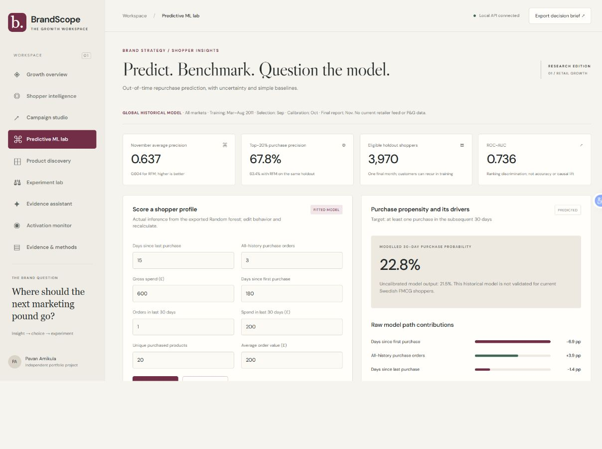
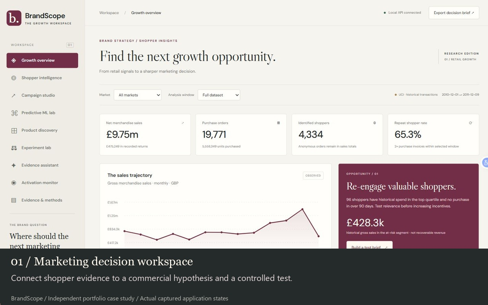
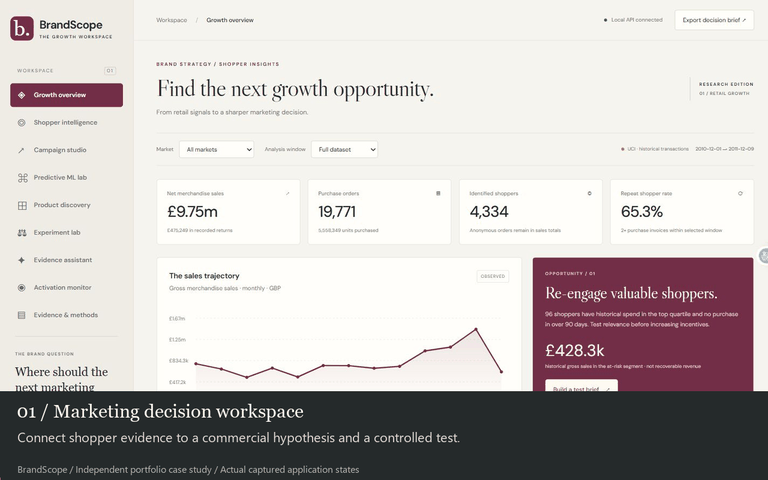
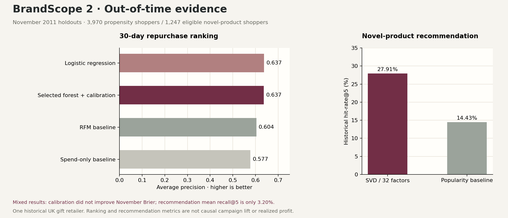
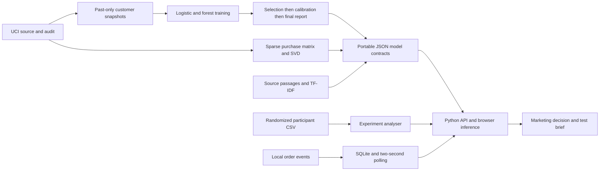

<div align="center">

# BrandScope 2
### Shopper intelligence → predictive evidence → profitable marketing decisions

An independent brand management workspace with supervised repurchase modeling, learned product recommendations, an evidence retrieval assistant, and experiment-results analysis.

[Open application](https://pavan-amikula.github.io/brandscope/) · [Predictive ML lab](https://pavan-amikula.github.io/brandscope/#prediction) · [Video demonstration](docs/assets/brandscope-demo.mp4) · [Model card](docs/MODEL_CARD.md)


</div>



## The brand management decision

Which shoppers deserve attention, which product hypothesis is worth testing, and could the action grow contribution after incentives and campaign costs? BrandScope connects a reproducible retail-data audit to those choices, then makes the quality and limits of the evidence visible.

Built around the supplied P&G Stockholm Brand Management Summer Internship 2027 description. Public P&G material about consumer-first analytics and other marketing portfolios informed the upgrade; [the research register](docs/UPGRADE_RESEARCH.md) explains what was reviewed and implemented. This is an independent portfolio case, not P&G employment, commissioned work or an executed campaign. Transaction data does not replace consumer research.

## Two-minute recruiter tour

1. **[Predictive ML lab](https://pavan-amikula.github.io/brandscope/#prediction):** edit a behavior profile and run the actual fitted model. Inspect explanations, baselines, calibration and capacity trade-offs.
2. **[Product discovery](https://pavan-amikula.github.io/brandscope/#recommendations):** choose purchased products and compare learned-factor recommendations with popularity.
3. **[Experiment lab](https://pavan-amikula.github.io/brandscope/#experiment):** load the labelled synthetic example. Conversion evidence is positive, but the primary contribution interval crosses zero. A CSV upload/paste workflow accepts your own valid test outcomes.
4. **[Evidence assistant](https://pavan-amikula.github.io/brandscope/#assistant):** ask about the Swedish sample or model results, inspect source passages, then try an unrelated question to see abstention.
5. **Campaign studio:** increase the assumed discount from 5% to 20%; modelled contribution changes from £255 to −£825. Save a scenario and export its brief.

## Demonstration

[](docs/assets/brandscope-demo.mp4)

**[Watch / download the MP4](https://github.com/Pavan-amikula/brandscope/raw/refs/heads/main/docs/assets/brandscope-demo.mp4)** · [Storyboard and captions](docs/DEMO.md)

The captioned demonstration is assembled from actual captured states of the running application, with no audio; it is not a continuous screen recording or a claim of a real retailer integration.



## Measured evidence, including mixed results



| Capability | Final November 2011 evidence | Meaning |
| --- | --- | --- |
| Supervised purchase ranking | Random forest average precision **0.6367**, vs **0.6036 RFM** and **0.5770 spend-only** | All methods evaluated on the same 3,970 shoppers |
| Capacity-constrained targeting diagnostic | Top-20% precision **67.76%**, vs **63.35% RFM** | Purchase likelihood, not incremental offer response |
| Fixed-model uncertainty check | AP difference vs RFM **0.0331**, bootstrap interval **[0.0221, 0.0440]** | 500 paired shopper resamples, one holdout month |
| Novel-product recommendation | SVD hit-rate@5 **27.91%**, vs **14.43% popularity** | 1,247 known shoppers with a novel future purchase |
| Recommendation recall | Mean recall@5 **3.20%** | Low recall and catalog limits remain visible |
| Source data | **541,909** source rows; **530,784** retained merchandise rows | Full workbook audit, not a cherry-picked sample |
| Verification | **50 Python tests**, plus executable browser/Python reference checks | Feature-time contracts, inference, APIs, storage and statistical calculations |

The forest was selected in **September**, calibration was fitted in **October**, and **November** was reserved for final reporting. Logistic regression slightly exceeds the forest on final-month AP. Calibration does **not** improve November Brier score (0.1870 vs 0.1860 raw forest). We keep the preselected protocol and disclose those outcomes.

Recommendation scores do not establish sales uplift. Only 36.74% of novel targets fall in the fitted top-500 candidate catalog. The browser's one/two-seed interaction differs from the full-history benchmark context. See [exact results and CSVs](docs/outputs/ML_RESULTS.md) and the [model card](docs/MODEL_CARD.md).

## Working capabilities

| Workspace | What actually works |
| --- | --- |
| Growth overview | Four market selections, full/90-day windows, gross/net/returns reconciliation, trends and shopper opportunity |
| Shopper intelligence | Five rule-based RFM segments, retention cohorts, product search and directional basket associations |
| Campaign studio | Contribution delta with baseline discount cannibalization, break-even conversion, approximate power check, saved scenarios and Markdown brief export |
| Predictive ML lab | Exported random-forest inference, logistic baseline, separate sigmoid calibration, local tree-path explanations, permutation inspection, reliability bins, drift and capacity diagnostics |
| Product discovery | 32-factor TruncatedSVD product embeddings, personalized seed ranking, popularity comparison and temporal recommendation evaluation |
| Experiment lab | CSV upload/paste, unique-participant validation, contribution and conversion differences, approximate 95% intervals and 50:50 sample-ratio mismatch diagnostics |
| Evidence assistant | Fitted English TF-IDF retrieval over source passages, links and abstention; **retrieval NLP, not a generative LLM** |
| Activation monitor | Real local HTTP event ingestion, event-ID deduplication, SQLite persistence and two-second polling; explicit browser-store fallback on public hosting |
| Evidence & methods | Data audit, original RFM diagnostics, methods, attribution and scope boundaries |

## Run locally — no API keys or model downloads

Python 3.12+ is recommended. The application runtime uses the standard library and committed JSON model parameters. It does not deserialize pickle/joblib files or require sklearn to serve predictions.

```bash
git clone https://github.com/Pavan-amikula/brandscope.git
cd brandscope
python server.py
```

Open **http://127.0.0.1:8765**. An alternative port is supported with `python server.py --port 9000`.

For a static preview only:

```bash
python -m http.server 8000 --directory web
```

Open **http://localhost:8000**. Browser inference, recommendations, evidence retrieval and experiment calculations work in static mode. Events and scenarios use browser storage; the public static host does not run the Python API. Uploaded experiment records are not saved in browser storage. Optional Google Fonts have local fallbacks.

## Rebuild and verify

```bash
python -m pip install -r requirements-ml.txt
python scripts/build_data.py
python scripts/train_models.py
python scripts/train_recommender.py
python scripts/build_experiment_demo.py
python scripts/build_knowledge.py
python scripts/export_results.py
python scripts/export_ml_report.py
python -m unittest discover -s tests -v
node scripts/check_browser_models.cjs
```

The original UCI ZIP is downloaded by the data script; use `--zip path/to/online-retail.zip` to reuse a download. Raw data and runtime databases are Git-ignored. The full test run requires requirements-ml.txt; without optional ML libraries, four feature-construction tests skip, while portable inference/API checks remain runnable. The optional benchmark PNG exporter uses matplotlib. Optional walkthrough regeneration: install requirements-demo.txt and run `python scripts/build_demo.py` using the committed screenshots.

## Local API

| Endpoint | Capability |
| --- | --- |
| GET `/api/health` | Readiness |
| GET / POST `/api/events` | Latest events / validated idempotent order ingestion |
| GET / POST `/api/plans` | Read / save planning scenarios |
| POST `/api/campaign` | Commercial scenario calculation; rate inputs are fractions |
| POST `/api/predict` | Score the eight documented behavior features |
| POST `/api/recommend` | Product codes and optional `svd` / `popularity` method |
| POST `/api/ask` | Retrieve project passages for a question |
| POST `/api/experiment` | Analyse validated participant records |

Example product request:

```bash
curl http://127.0.0.1:8765/api/recommend -H "Content-Type: application/json" -d '{"codes":["85123A","22423"]}'
```

Windows PowerShell:

```powershell
$requestBody = @{ codes = @('85123A', '22423') } | ConvertTo-Json
Invoke-RestMethod 'http://127.0.0.1:8765/api/recommend' -Method Post -ContentType 'application/json' -Body $requestBody
```

The server binds to loopback, validates write Host/Origin, constrains body sizes and rejects malformed inputs. It is a demonstration service. Shared use needs authentication, signed ingestion, consent governance, operational monitoring and a deployment design appropriate for business data.

## Architecture



## Research and role alignment

Reviewed P&G's own public LinkedIn material on consumer-first analytics and data transparency, public RFM/marketing portfolios, the Recommenders project, sklearn calibration/inspection/SVD documentation, and EconML/Robyn for causal-data requirements. [The upgrade research register](docs/UPGRADE_RESEARCH.md) records implementation choices and exclusions. No other project's source code or self-reported metrics are copied.

The original dataset and methodology references remain [Chen, UCI Online Retail](https://doi.org/10.24432/C5BW33), [Chen, Sain & Guo (2012)](https://doi.org/10.1057/dbm.2012.17), [Wan et al., ACM WWW (2022)](https://dl.acm.org/doi/10.1145/3487553.3524707), and [Kohavi et al., ACM KDD (2007)](https://exp-platform.com/practical-guide/). The [original research register](docs/RESEARCH.md) explains each reference's role. Full papers are not redistributed.

Brand management evidence includes shopper analysis, explicit marketing choices, commercial trade-offs, experiment interpretation and clear decision communication. It does not establish consumer motivations, Swedish fluency, education eligibility or real team leadership. [Role mapping](docs/ROLE_ALIGNMENT.md) makes those boundaries explicit.

## Important limits

One **2010–2011 UK gift retailer**, with wholesale buyers and no brand, media-exposure, margin or treatment labels. The Swedish subset contains only **eight identified shoppers and 34 orders**. These data cannot establish current Swedish FMCG demand, brand awareness, causal offer response or realized marketing ROI. The synthetic experiment is labelled throughout. No uplift, MMM, generative LLM, deep learning or production authentication is claimed.

Code and more algorithms cannot guarantee recruitment. The project's strongest evidence is that it connects a marketing question to working software, measured comparisons and a defensible decision.

## Reading pack and outputs

- [Complete resume handoff](docs/RESUME_HANDOFF.md)
- [Model card and data label](docs/MODEL_CARD.md)
- [Exact ML results and CSV outputs](docs/outputs/ML_RESULTS.md)
- [Original descriptive results](docs/outputs/RESULTS.md)
- [Marketing strategy and 10-week plan](docs/BRAND_STRATEGY.md)
- [Experiment contract and statistical limits](docs/EXPERIMENTS.md)
- [Verification record](docs/VERIFICATION.md)

Code: [MIT](LICENSE). UCI data and derived aggregates: [CC BY 4.0 attribution](DATA_LICENSE.md). No endorsement by P&G, UCI or cited authors is implied.
