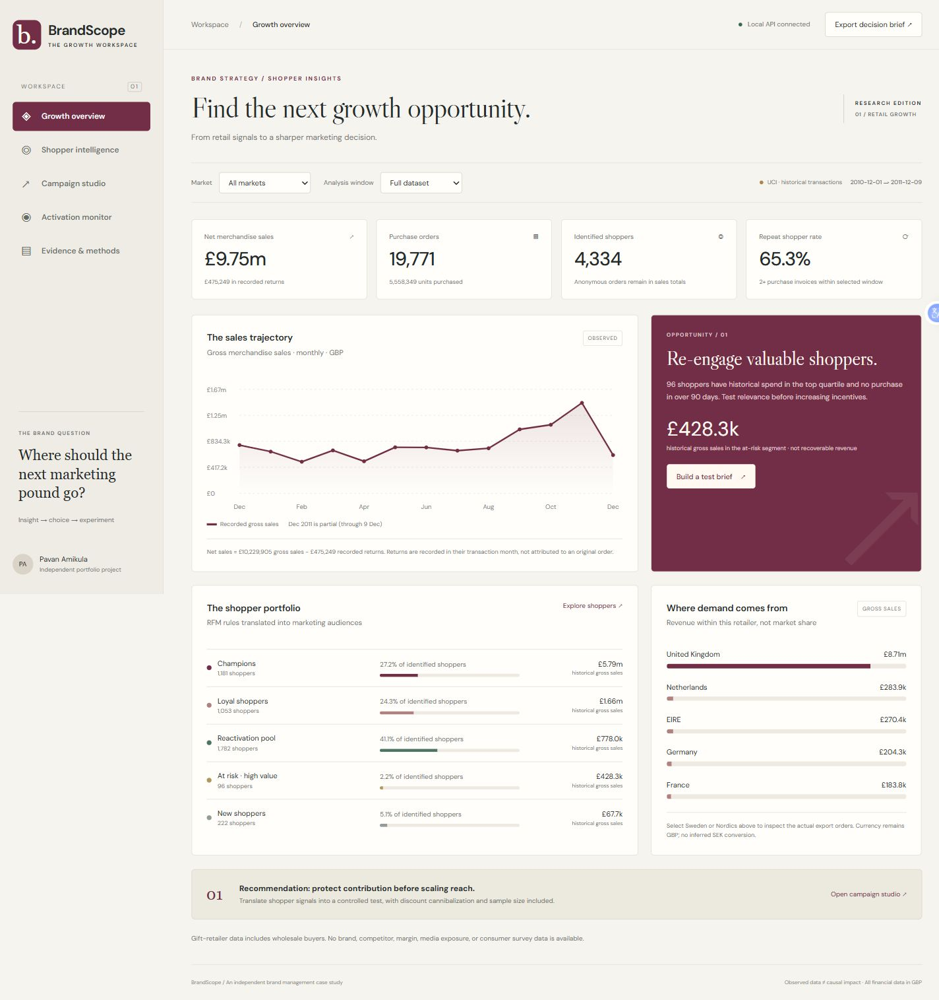
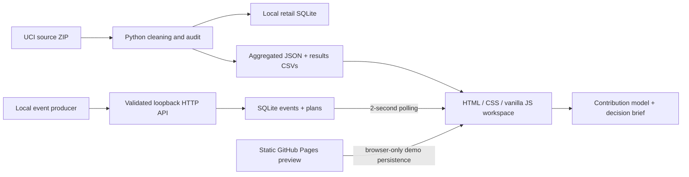

<div align="center">

# BrandScope
### Shopper evidence. Better marketing choices. Profitable growth.

An independent brand management case study connecting retail analytics to campaign planning, commercial trade-offs and near-real-time activation monitoring.

[Open interactive preview](https://pavan-amikula.github.io/brandscope/) · [Watch the walkthrough](docs/assets/brandscope-demo.mp4) · [Measured results](docs/outputs/RESULTS.md) · [Strategy brief](docs/BRAND_STRATEGY.md)


</div>



## The business problem

A brand manager needs to decide **which shoppers to prioritize, what action to test, and whether that action can grow contribution**. A sales total alone cannot answer those questions. BrandScope moves from observed transaction evidence to an explicit commercial hypothesis, a test brief, and a working event monitor.

Designed around the supplied P&G Stockholm Brand Management Summer Internship 2027 description: shopper understanding, marketing plans, profitable growth, analytical capability and clear communication. This is an independent portfolio project, not work commissioned by P&G. Personal eligibility, Swedish proficiency and actual leadership experience require separate evidence.

## A recruiter’s two-minute tour

1. Open the [interactive preview](https://pavan-amikula.github.io/brandscope/). Inspect the **Growth overview** and select **Sweden** to see how a small export sample changes the interpretation.
2. Open **Shopper intelligence** for segments, retention cohorts and basket associations. Product search filters the opportunity list.
3. Open **Campaign studio**. Increase the discount from 5% to 20%: the same assumed demand gain changes from **£255 to −£825** modelled contribution. Save a scenario and download its decision brief.
4. Open **Activation monitor** and send demo events. The hosted preview stores these in your browser; running the Python server enables the real SQLite-backed ingestion API.
5. Open **Evidence & methods** for the audit, temporal ranking results and research references.

### Video demonstration

[](docs/assets/brandscope-demo.mp4)

**[Watch / download the MP4](https://github.com/Pavan-amikula/brandscope/raw/refs/heads/main/docs/assets/brandscope-demo.mp4)** · [Storyboard and captions](docs/DEMO.md)

The captioned walkthrough is assembled from actual captured states of the running application. It shows observed analysis, market filtering, contribution stress testing and the working event monitor; it is not a claim of live retailer integration. The animated preview below provides an inline overview if GitHub does not play the MP4 directly.


## Evidence and results

| Result | Verified output | Interpretation |
| --- | ---: | --- |
| Entire source workbook processed | 541,909 rows | No cherry-picked sample |
| Merchandise rows retained | 530,784 | Returns kept; cleaning audit reconciles |
| Historical net merchandise sales | £9,754,656.49 | Source data total, not value created by the project |
| Purchase orders / identified shoppers | 19,771 / 4,334 | Anonymous sales retained in totals |
| RFM top-20% repurchase precision | 51.11%–59.37% | Three past-only, 30-day historical holdouts |
| RFM precision / overall repurchase rate | 1.89×–2.35× | Descriptive ranking lift, not campaign uplift |
| High-value inactive audience | 96 shoppers | £428,269.16 past gross spend; not guaranteed recoverable revenue |
| Swedish subset | 8 shoppers / 34 orders | Too small for national market inference |
| Automated checks | 17 passing | Analytics, data reconciliation and HTTP/SQLite integration |

The spend-only ranker is also reported, not hidden: its precision ranges from 50.42% to 56.95%, with a smaller gap from RFM at the final cutoff. No significance, future performance or realized ROI claim is made. See [machine-readable results](docs/results.json), [CSV exports](docs/outputs/) and [metric definitions](docs/METHODS.md).

## What works

| Workspace | Working capability |
| --- | --- |
| Growth overview | Four market selections, full/90-day windows, gross/net/returns reconciliation, monthly trend and commercial opportunity |
| Shopper intelligence | Mutually exclusive RFM segments, cohort retention, product search and directional basket associations |
| Campaign studio | Contribution delta, baseline discount cannibalization, break-even conversion gain, approximate conversion sample size, scenario saving and Markdown brief export |
| Activation monitor | Validated HTTP order events, explicit synthetic flag, idempotent event IDs, SQLite persistence and two-second polling; browser-only fallback in static preview |
| Evidence & methods | Source audit, three temporal ranking checks, research register and explicit inference boundaries |

The near-real-time layer is functional ingestion and polling; it is not a WebSocket stream or an existing retailer integration. Historic analytics never silently mix with generated events. The loopback server is a demonstration service, not an authenticated production platform.

## Run locally — no API keys required

Python 3.12+ is recommended. The app and its tests use only the standard library; the aggregate dataset is already committed.

```bash
git clone https://github.com/Pavan-amikula/brandscope.git
cd brandscope
python server.py
```

Open **http://127.0.0.1:8765**. Another port: `python server.py --port 9000`.

To use only the static preview:

```bash
python -m http.server 8000 --directory web
```

Open **http://localhost:8000**. Static mode provides all bundled analytics and browser-side scenario calculations. Events and plans stay in that browser; no backend ingestion exists in this mode. Optional Google Fonts have local font fallbacks.

### Rebuild from original public data

```bash
python -m pip install -r requirements.txt
python scripts/build_data.py
python scripts/export_results.py
```

The pipeline downloads the original 22.6 MB workbook ZIP from UCI, fingerprints it, cleans all rows, builds the aggregate bundle and creates a local row-level SQLite database. Runtime varies by machine. Raw data and SQLite files are Git-ignored. `--zip path/to/online-retail.zip` reuses a local download.

```bash
python -m unittest discover -s tests -v
node --check web/app.js
```

Node is only needed for the optional JavaScript syntax check; it is not required to run the app. GitHub Actions runs both checks and publishes `web/` to GitHub Pages.

### Send an external event locally

```bash
curl http://127.0.0.1:8765/api/events \
  -H "Content-Type: application/json" \
  -d '{"event_id":"order-unique-0001","market":"Sweden","channel":"CRM","amount_pence":4500,"synthetic":false}'
```

For Windows PowerShell:

```powershell
$eventBody = @{
  event_id = 'order-unique-0001'; market = 'Sweden'; channel = 'CRM'
  amount_pence = 4500; synthetic = $false
} | ConvertTo-Json
Invoke-RestMethod 'http://127.0.0.1:8765/api/events' -Method Post -ContentType 'application/json' -Body $eventBody
```

The response is `inserted: true` on first receipt and `false` on repeat. The `synthetic` flag must describe the actual origin: set it to true for fabricated/test orders. The API stamps receipt time in UTC and records amounts in integer GBP pence. Supported markets/channels and schema validation are in `server.py`.

| Endpoint | Purpose |
| --- | --- |
| GET `/api/health` | Local service readiness |
| GET / POST `/api/events` | Read latest 30 events / ingest one idempotent order event |
| GET / POST `/api/plans` | Read / save planning scenarios |
| POST `/api/campaign` | Calculate validated commercial assumptions; rate inputs are fractions |

The demo binds only to loopback, validates write Host/Origin headers, restricts body sizes and rejects invalid events. Shared operation needs authentication, signed ingestion, consent governance, rate limiting and monitoring. No contact details or raw customer identifiers are published.

## Architecture



```text
analytics.py              Commercial model and RFM rules
server.py                 Loopback HTTP API, persistence and static files
scripts/build_data.py     Full-data audit, segmentation, cohorts, baskets, holdouts
scripts/export_results.py CSVs and readable measured-results report
web/                      Responsive interface and aggregate JSON snapshot
tests/                    Standard-library unit and HTTP integration tests
docs/                     Strategy, methods, role mapping, results and demo assets
.github/workflows/        Verification and GitHub Pages publication
```

## Research and attribution

- [Chen, UCI Online Retail (2015)](https://doi.org/10.24432/C5BW33): source data, **CC BY 4.0**.
- [Chen, Sain & Guo (2012)](https://doi.org/10.1057/dbm.2012.17): customer-centric RFM analysis; this project uses rules, not the paper's clustering implementation.
- [Wan et al., ACM WWW (2022)](https://dl.acm.org/doi/10.1145/3487553.3524707): ACM abstract reviewed for RFM threshold and pattern-mining context; algorithm not reproduced.
- [Kohavi, Henne & Sommerfield, ACM KDD (2007)](https://exp-platform.com/practical-guide/): controlled experimentation and measurement discipline.
- [Microsoft Retail Analysis sample](https://learn.microsoft.com/en-us/power-bi/create-reports/sample-retail-analysis): interface information hierarchy.
- Comparable public projects and what was learned from them are documented in [RESEARCH.md](docs/RESEARCH.md). No third-party source code or full papers are copied.

## Scope that matters

The dataset covers a **2010–2011 UK gift retailer**, includes wholesale customers and lacks brand labels, consumer surveys, margins, media exposure, competitor sales and campaign outcomes. It cannot establish brand awareness, consumer motivation, market share, current Swedish demand, causal response or realized marketing ROI. Swedish text is a reviewable draft, not evidence of language fluency. The default planning scenario is independent of the observed 96-person at-risk audience.

The project demonstrates a useful workflow and auditable analysis. It does not meet personal qualification requirements automatically or guarantee recruitment.

## Project reading pack

- [Full project and resume handoff](docs/RESUME_HANDOFF.md)
- [Role requirement mapping](docs/ROLE_ALIGNMENT.md)
- [Marketing strategy and 10-week action plan](docs/BRAND_STRATEGY.md)
- [Exported in-app decision brief](docs/EXPORTED_DECISION_BRIEF.md)
- [Data, metrics and evaluation](docs/METHODS.md)
- [Verification record](docs/VERIFICATION.md)

Code: [MIT](LICENSE). Data and derived aggregates: [CC BY 4.0 attribution](DATA_LICENSE.md).
